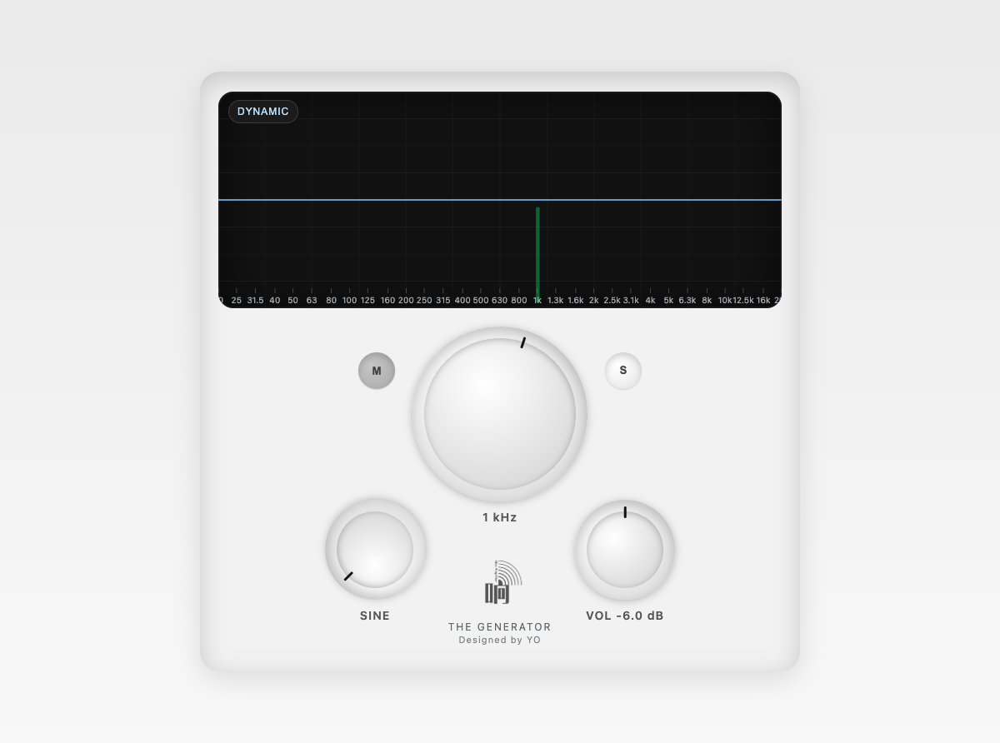

# The Generator

**A signal generator that lives in your browser.** Nothing to install.

**[Open it →](https://ideaamplifier.github.io/TheGenerator/)**

- Sine, square, saw and triangle
- Frequency knob that steps through the ISO 1/3-octave centres, 20 Hz to 20 kHz
- One-button sweep from 20 Hz to 20 kHz
- Volume in dB, mute, and a live scope / spectrum view

Handy for a quick line check or ringing out a wedge when the proper tools are still in the truck.

---

Free · by [ideaAmplifier](https://github.com/IdeaAmplifier)
